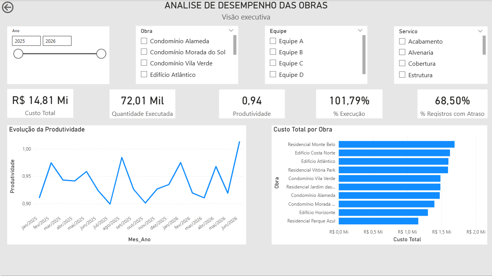
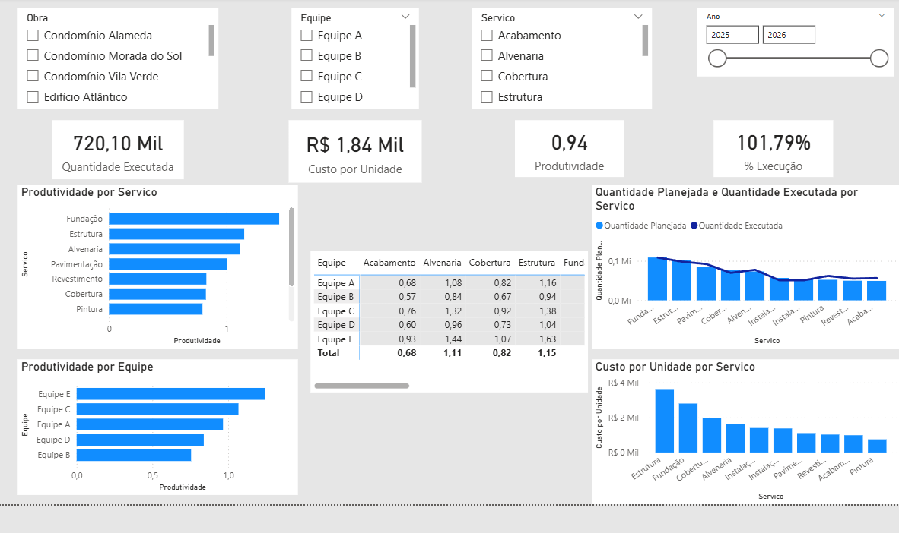
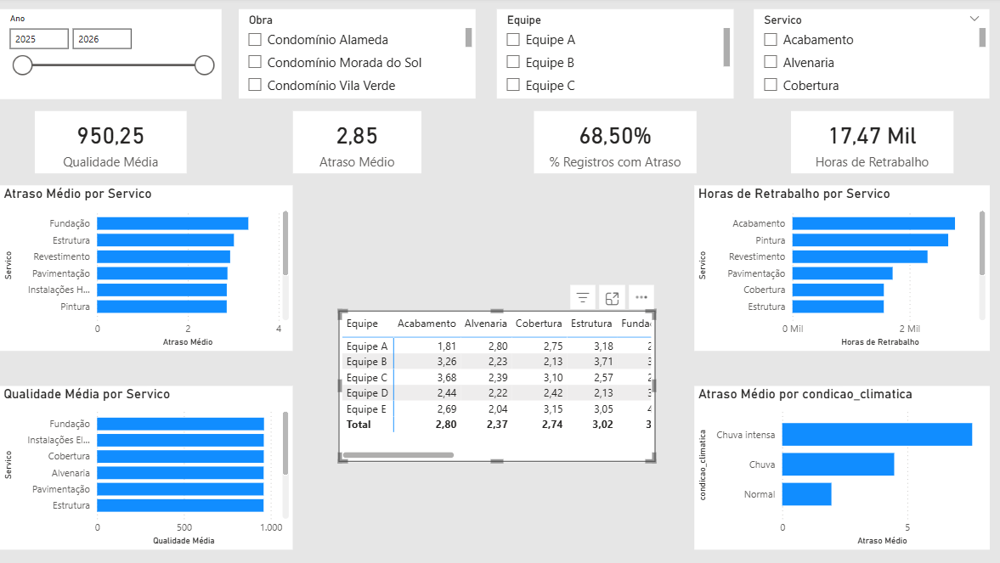

# 📊 Análise de Desempenho de Obras

## 📌 Sobre o projeto

Este projeto apresenta uma análise de dados aplicada ao contexto de gerenciamento e acompanhamento de obras.

O objetivo foi utilizar dados operacionais de obras para analisar produtividade, custos, execução do planejamento, qualidade, atrasos e retrabalho.

O projeto foi desenvolvido como parte do meu portfólio de Análise de Dados, utilizando Python, SQL e Power BI.

> **Observação:** o dataset utilizado neste projeto é sintético e foi desenvolvido para fins educacionais e de portfólio.

---

## 🎯 Objetivo

Analisar o desempenho operacional de diferentes obras, equipes e serviços, buscando identificar padrões relacionados a:

- produtividade;
- custos;
- execução planejada versus realizada;
- atrasos;
- qualidade;
- retrabalho;
- condições climáticas.

A análise foi estruturada desde o tratamento dos dados até a construção de um dashboard interativo no Power BI.

---

## ❓ Perguntas de negócio

Durante o projeto foram investigadas perguntas como:

- Qual é o custo total das obras?
- Qual quantidade foi executada?
- Qual percentual do planejado foi executado?
- Como a produtividade varia ao longo do período?
- Como a produtividade varia entre as equipes?
- Como a produtividade varia entre os serviços?
- Quais serviços apresentam maior custo por unidade?
- Quais serviços apresentam maior atraso médio?
- Existe associação entre condições climáticas e atrasos?
- Quais serviços concentram maior volume de retrabalho?
- Existe relação entre qualidade e retrabalho?

---

## 🗂️ Dados

O dataset contém registros relacionados à execução de serviços em diferentes obras.

Entre as principais informações estão:

- obra;
- cidade;
- equipe;
- serviço;
- data;
- quantidade planejada;
- quantidade executada;
- horas trabalhadas;
- custo realizado;
- dias de atraso;
- horas de retrabalho;
- índice de qualidade;
- condição climática.

O conjunto de dados é sintético e não representa dados reais de empresas ou obras específicas.

---

## 🐍 Análise com Python

O Python foi utilizado para:

- exploração inicial dos dados;
- identificação de possíveis inconsistências;
- tratamento e preparação dos dados;
- análise estatística e descritiva;
- análise de produtividade;
- análise de custos;
- análise por equipe;
- análise por serviço;
- geração de tabelas-resumo.

Principais bibliotecas utilizadas:

- Pandas
- NumPy
- Matplotlib

O notebook completo está disponível em:

`notebooks/01_analise_obras.ipynb`

---

## 🗄️ Análise com SQL

Foi utilizado SQLite para realizar consultas analíticas sobre os dados tratados.

Entre as análises realizadas estão:

- agregações por equipe;
- agregações por serviço;
- cálculo de produtividade;
- custo por unidade;
- análise de atrasos;
- classificação utilizando `CASE WHEN`;
- CTEs;
- funções de janela;
- ranking de equipes;
- análise temporal;
- comparação entre quantidade planejada e executada.

As consultas estão disponíveis em:

`sql/queries.sql`

---

## 📊 Dashboard Power BI

O Power BI foi utilizado para construir um dashboard interativo baseado em um modelo dimensional.

### Página 1 — Visão Executiva

Apresenta os principais indicadores gerais:

- custo total;
- quantidade executada;
- produtividade;
- percentual de execução;
- percentual de registros com atraso;
- evolução da produtividade;
- custo total por obra.



---

### Página 2 — Análise Operacional

Analisa diferenças de desempenho entre equipes e serviços.

Principais análises:

- produtividade por equipe;
- produtividade por serviço;
- custo por unidade;
- quantidade planejada versus executada;
- análise de produtividade por equipe e serviço.



---

### Página 3 — Qualidade e Atrasos

Analisa aspectos relacionados à qualidade e ao cumprimento dos prazos.

Principais análises:

- qualidade média;
- atraso médio;
- percentual de registros com atraso;
- horas de retrabalho;
- atraso por serviço;
- atraso por condição climática;
- retrabalho por serviço;
- qualidade por equipe e serviço.



---

## 🔎 Principais insights

### 1. Execução planejada versus atrasos

A execução acumulada correspondeu a **101,79% do planejado**.

Ao mesmo tempo, **68,50% dos registros apresentaram algum atraso**.

Esse resultado demonstra que atingir o volume planejado não significa necessariamente que todas as atividades tenham sido executadas dentro do prazo.

---

### 2. Diferença de produtividade entre equipes

A produtividade agregada foi de aproximadamente **0,94**.

Entre as equipes analisadas, os resultados variaram aproximadamente entre:

- Equipe E: **1,24**
- Equipe C: **1,07**
- Equipe A: **0,97**
- Equipe D: **0,84**
- Equipe B: **0,76**

A análise por equipe e serviço indica que o tipo de atividade deve ser considerado ao comparar os resultados das equipes.

---

### 3. Produtividade e atraso representam dimensões diferentes

O serviço de Fundação apresentou produtividade elevada, mas também apresentou um dos maiores níveis de atraso médio, aproximadamente **3,4 dias**.

Isso demonstra que produtividade e cumprimento de prazo devem ser analisados separadamente.

---

### 4. Condições climáticas e atrasos

Os registros associados a condições climáticas mais adversas apresentaram maior atraso médio.

A categoria **Chuva intensa** apresentou atraso médio substancialmente superior à condição **Normal**.

Esse resultado representa uma associação observada nos dados e não uma demonstração de causalidade.

---

### 5. Retrabalho

Foram identificadas aproximadamente **17,47 mil horas de retrabalho**.

O maior volume foi observado nos serviços de **Acabamento** e **Pintura**.

Uma análise complementar utilizando a taxa de retrabalho pode ajudar a comparar serviços com diferentes volumes de trabalho.

---

## 🛠️ Tecnologias utilizadas

- Python
- Pandas
- NumPy
- Matplotlib
- SQL
- SQLite
- Power BI
- DAX
- Google Colab

---

## ▶️ Como executar o projeto

### 1. Pré-requisitos

- Python instalado
- Bibliotecas listadas em `requirements.txt`

### 2. Instalar as dependências

No terminal, execute:

```bash
pip install -r requirements.txt
```

### 3. Executar o script de análise

Na pasta principal do projeto, execute:

```bash
python src/analise_obras.py
```

Os resultados serão salvos em `resultados/EDA/`.

### 4. Explorar o notebook

Abra `notebooks/01_analise_obras.ipynb` no VS Code ou Google Colab.

O notebook utiliza dados do projeto e pode exigir ajustes de caminho conforme o ambiente de execução.

### 5. Visualizar o dashboard

Abra `powerbi/Projeto 01.pbix` no Power BI Desktop.

---

## 📁 Estrutura do projeto


```text
projeto_01_analise_obras/
├── data/
│   ├── raw/
│   │   └── obras_produtividade.csv
│   └── processed/
│       ├── obras_produtividade_tratado.csv
│       └── obras.db
├── notebooks/
│   └── 01_analise_obras.ipynb
├── src/
│   └── analise_obras.py
├── sql/
│   └── queries.sql
├── powerbi/
│   ├── Projeto 01.pbix
│   └── README_POWERBI.md
├── imagens/
│   ├── analise_operacional.png
│   ├── qualidade_atrasos.png
│   └── visao_executiva.png
├── resultados/
│   └── EDA/
│       ├── 01_servicos.csv
│       ├── 02_equipes.csv
│       ├── 03_obras.csv
│       ├── 04_clima.csv
│       ├── 05_evolucao_mensal.csv
│       ├── produtividade_por_servico.png
│       ├── resumo_equipes.csv
│       └── resumo_servicos.csv
├── .gitignore
├── README.md
└── requirements.txt
```
